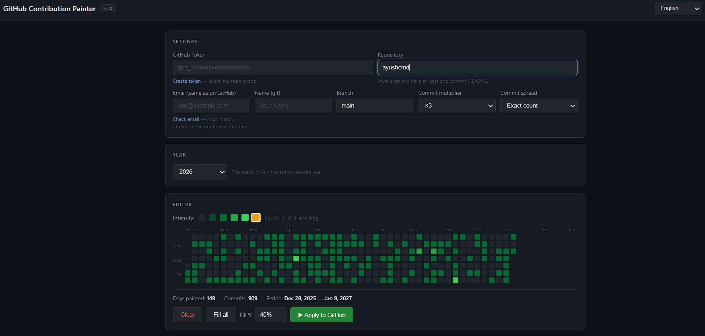

> Turn your GitHub contribution graph into pixel-art by generating backdated commits from a web UI.


[](requirements.txt)
[](js/app.js)
[](vercel.json)
[](.github/workflows/ai-issue.yml)

<p align="center">
  
</p>

## Table of Contents

- [Features](#features)
- [Technology Stack](#technology-stack)
- [Technical Block](#technical-block)
  - [Project Structure](#project-structure)
  - [Key Design Decisions](#key-design-decisions)
- [Getting Started](#getting-started)
  - [Prerequisites](#prerequisites)
  - [Installation](#installation)
- [Testing](#testing)
- [Deployment](#deployment)
- [Usage](#usage)
- [Configuration](#configuration)
- [License](#license)
- [Contacts](#contacts)

## Features

Contribution Painter is built for devs who want deterministic control over contribution heatmaps without touching heavy frameworks.

- Interactive GitHub-style yearly heatmap editor with drag-to-paint controls.
- Intensity model (`0..4`) + commit multiplier (`x1/x3/x5/x10`) for fast density scaling.
- Year selection across current, previous, and next years with automatic week-grid alignment.
- Keyboard shortcuts (`0..4`) for instant palette switching.
- Graph operations: clear canvas, fill all active cells, invert paint state.
- Real-time stats: painted days, estimated commit count, and active period boundaries.
- Direct GitHub REST API push pipeline that writes git blobs, trees, commits, and branch refs.
- Supports creating a new branch if the target branch does not exist.
- Multi-language UI via pluggable i18n dictionaries.
- Progress bar + live logs for long-running commit generation jobs.
- Vercel-ready static deployment config.
- AI-driven GitHub Action that analyzes code changes and opens structured issues.

> [!IMPORTANT]
> The tool creates real commits in your repository history. Use it only in repos where rewritten contribution history is acceptable.

## Technology Stack

### Core
- `HTML5` for the single-page UI shell.
- `CSS3` for GitHub-like contribution graph styling.
- `Vanilla JavaScript` for editor state, i18n, and GitHub API integration.

### Backend Automation
- `Python 3.11+` for GitHub Action automation script.
- `PyGithub`, `requests`, `python-dotenv` for GitHub and model API orchestration.

### DevOps / Infra
- `GitHub Actions` for automated push/PR analysis.
- `Vercel` static hosting config for frontend deployment.

## Technical Block

### Project Structure

```text
.
├── index.html                  # Main web app entrypoint
├── css/
│   └── styles.css              # UI styles
├── js/
│   ├── app.js                  # Painter logic
│   └── i18n/                   # Localization dictionaries
├── images/
│   ├── contribution_painter_loop.svg # Hero animation
│   └── demo.png                # Demo screenshot
├── trigger action/
│   └── trigger_action.py       # Automation script
├── .github/
│   └── workflows/
│       └── ai-issue.yml        # CI workflow invoking AI issue generator
├── requirements.txt            # Python dependencies for automation
└── vercel.json                 # Static hosting routing and headers
```

### Key Design Decisions

- Frontend is framework-free by design: lower bundle complexity, easier self-hosting, and easy auditability.
- Commits are generated via low-level Git Data API (`blobs/trees/commits/refs`) to allow exact commit timestamp control.
- The contribution editor maps to a week-column x weekday-row matrix to mirror GitHub contribution graph semantics.
- i18n dictionaries are split per locale to keep translation churn isolated and avoid monolithic translation files.
- CI analysis is decoupled from frontend runtime; automation lives in Python to leverage mature GitHub SDK ergonomics.

## Getting Started

### Prerequisites

Install these tools first:

- `git`
- `Python 3.11+`
- `pip`
- Optional for frontend local dev convenience: `python -m http.server` or any static file server
- A GitHub personal access token with `repo` scope for writing commits

> [!TIP]
> For testing safely, create a throwaway repository with a single seed commit (`README.md`) before pushing generated history.

### Installation

```bash
# 1) Clone repository
git clone https://github.com/Readmify/contribution-painter.git
cd contribution-painter

# 2) Set up Python environment (for automation script and local checks)
python3 -m venv .venv
source .venv/bin/activate
pip install -r requirements.txt

# 3) Run a local static server for the frontend
python3 -m http.server 8080

# 4) Open in browser
# http://localhost:8080
```

## Testing

This project is lightweight and does not currently ship with a formal unit/integration test suite. You can still run practical validation checks.

```bash
# Python syntax check for backend automation
python3 -m py_compile process_event.py

# Optional: quick dependency sanity
python3 -m pip check

# Optional: run script help/debug in controlled env
# (requires env vars like GITHUB_TOKEN, GH_MODELS_TOKEN)
python3 process_event.py
```

> [!WARNING]
> Running `process_event.py` without required environment variables will fail by design.

## Deployment

### Frontend (Vercel)

The repository includes `vercel.json` for static deployment with SPA-style route fallback.

```bash
# Option A: Vercel CLI
npm i -g vercel
vercel

# Option B: connect repo in Vercel dashboard
# Vercel will serve index.html and route all paths back to it.
```

### CI/CD (GitHub Actions)

- On pushes to `main` and PR events, `ai-issue.yml` runs the Python analyzer.
- The workflow checks out code, installs Python, installs dependencies, and executes analysis script.

> [!CAUTION]
> Ensure secrets (`GH_MODELS_TOKEN`, optional `ALLOWED_USER`) are configured before enabling the workflow in production repos.

## Usage

Use the web UI to paint days and push generated commits.

```text
# 1. Open app in browser.
# 2. Fill in:
#    - GitHub Token (repo scope)
#    - Repository: <owner>/<repo>
#    - Email: exactly matching GitHub account email
#    - Git name and branch (optional, defaults to main)
# 3. Pick year + intensity + multiplier.
# 4. Paint graph cells with mouse (or hit keys 0-4 to switch levels).
# 5. Click "Push to GitHub" and monitor progress/log output.
```

Example local run:

```bash
python3 -m http.server 8080
# then visit http://localhost:8080 and execute push from UI
```

## Configuration

### UI Runtime Inputs

- `GitHub Token` (`repo` scope required for commit/branch writes)
- `Repository` (`owner/repo`)
- `Email` (must match GitHub account email for contribution graph attribution)
- `Name` (commit author/committer display name)
- `Branch` (target branch, created automatically when missing)
- `Commit multiplier` (scales commit volume per painted intensity)
- `Year` (drives graph date range)

### Workflow Environment Variables (for `process_event.py`)

- `GITHUB_TOKEN` – GitHub Actions token used by workflow.
- `REPOSITORY` – target repository identifier.
- `EVENT_NAME` – event type (`push`, `pull_request`, etc.).
- `COMMIT_SHA` – commit hash for push context.
- `PR_NUMBER` – PR number when running in PR context.
- `GH_MODELS_TOKEN` – token for model endpoint authentication.
- `ALLOWED_USER` – optional actor gate for execution.

